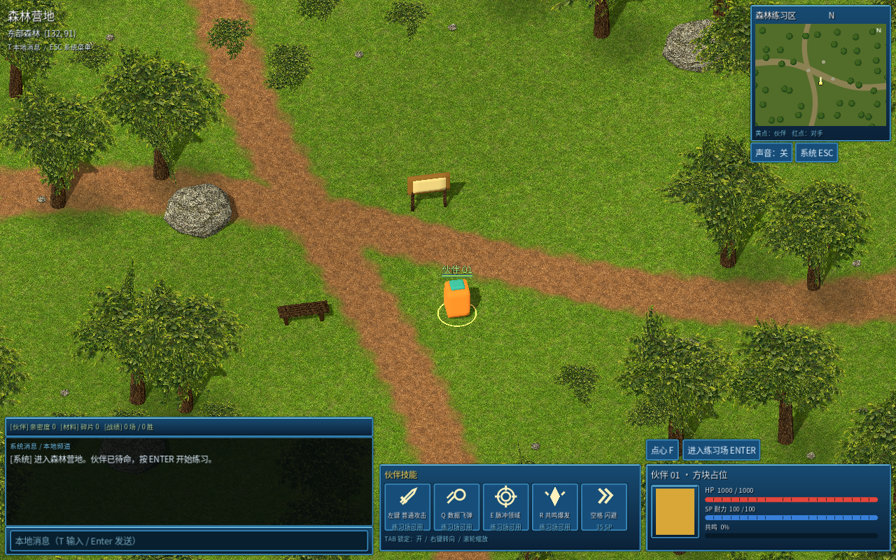
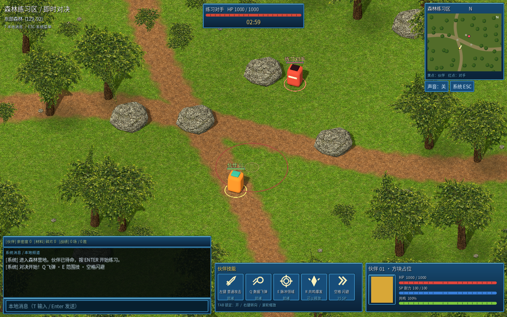
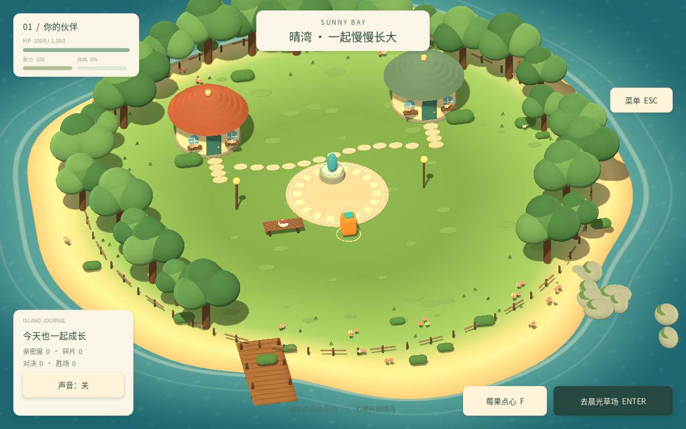
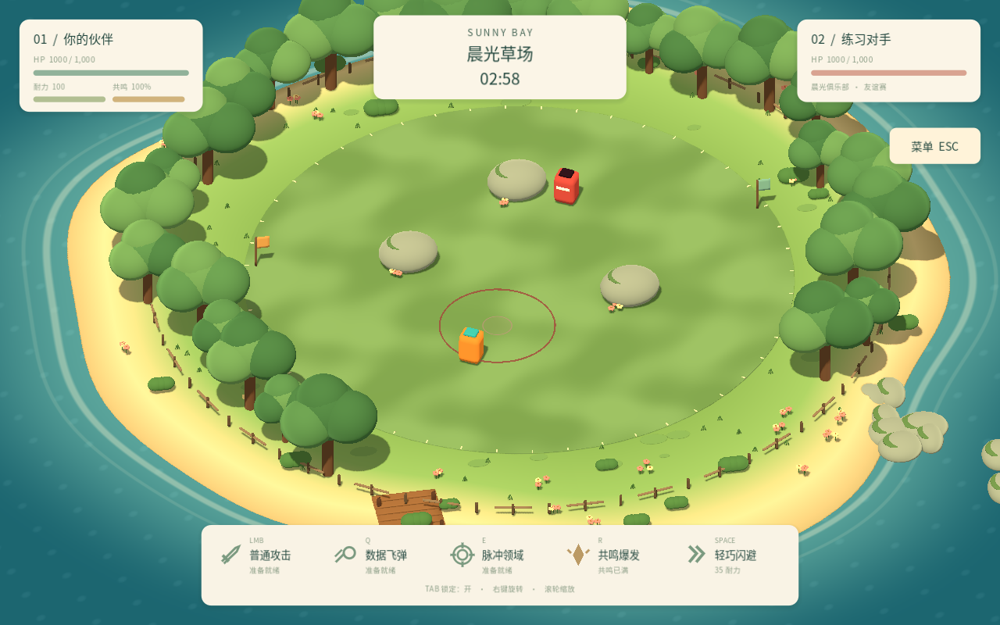

# 森林伙伴对决 · 方块原型 v0.3

## 当前版本 v0.3：纹理森林与经典蓝色界面

先看图片：[下载实际游戏截图包](https://github.com/Hetong-png/-/raw/refs/heads/downloads/Forest-v0.3-Actual-Screenshots.zip)。解压后打开两张 PNG，不需要游戏即可检查画面。

[下载 Windows 森林版客户端](https://github.com/Hetong-png/-/raw/refs/heads/downloads/SunnyBay-Windows-x64.zip)（约 46.5 MB）。解压后运行 SunnyBay.exe。

已实装草地与泥路材质混合、Alpha Scissor 树冠、纹理石头、蓝色 HUD、动态小地图、可点击技能槽与本地消息输入。角色仍为方块占位。34 项功能检查通过；Linux release 运行检查通过，Windows 尚未实机验收。

T 输入本地消息，Enter 发送；输入期间不会移动角色。本地消息不是联网聊天。草地等环境贴图为本项目生成，未加入数码兽模型、数码兽贴图或商业游戏提取物。

以下保留历史说明，v0.3 以森林版实际图片及本节为准。

## 下载 Windows 游戏

[点击下载 SunnyBay-Windows-x64.zip](https://github.com/Hetong-png/-/raw/refs/heads/downloads/SunnyBay-Windows-x64.zip)

下载约 35 MB。全部解压后双击 `SunnyBay.exe`，不需要安装 Godot。

## 操作

- Enter：从据点开始对战
- WASD：移动；右键拖动：旋转镜头；滚轮：缩放
- 左键：普攻；空格：闪避
- Q / E：技能；R：满能量大招
- Tab：锁定；Esc：暂停；F：据点喂食

当前为单人对 AI 的几何体原型，包含据点、即时对战、结算和本地存档。没有真实数码宝贝模型或联网。

32 项源码功能检查通过，Linux 打包版本完成运行检查；Windows 包已导出，尚未在 Windows 实机试玩。压缩包内包含操作说明与第三方许可。校验值见 SHA256SUMS.txt。

此分支仅提供游戏包，不替换开发中的源代码。

## v0.2 场景与界面更新

重做海岛沙滩与动态浪线、树丛花草、窗台小屋、木栈道、圆角占位体、奶油色轻量 UI 与技能图标、透明范围提示和命中碎光。角色仍为方块占位，不使用自制数码宝贝模型。32 项功能回归检查通过；Windows 实机性能仍未验收。

以下为游戏实际渲染截图，不是生成概念图。

